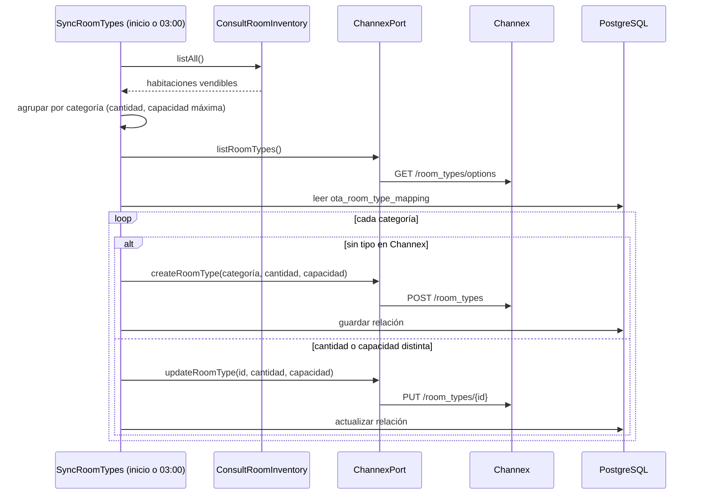
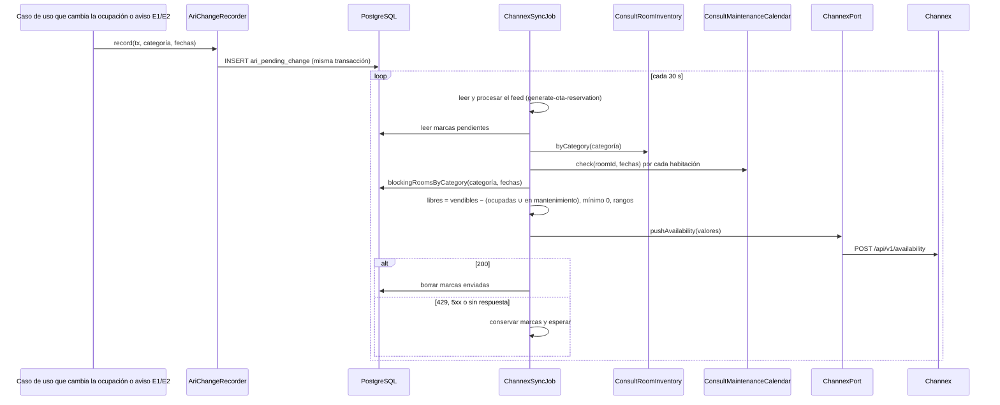

# Implementation Plan: Configurar OTA (`configure-ota`)

**Plan base**: [../base/plan.md](../base/plan.md)
**Spec**: [./spec.md](spec.md)
**Guía**: [../base/guia-planes-por-caso-de-uso.md](../base/guia-planes-por-caso-de-uso.md)

## Summary

Deja configurada la única agencia, **Booking.com**, conectada por **Channex** (`staging.channex.io`), y
mantiene en Channex lo que es del Módulo 2: los **tipos de habitación** y su **disponibilidad**. Tiene
cuatro capacidades:

1. **Configuración al iniciar**: valida la configuración, verifica que la propiedad exista en Channex y
   registra la `Ota` "Booking.com" con su porcentaje de comisión.
2. **Tipos de habitación**: traduce las habitaciones vendibles que informa el Módulo 1 a un tipo de
   habitación de Channex por categoría (cantidad y capacidad), los crea o los actualiza al iniciar y a
   las 03:00, y guarda la relación en `ota_room_type_mapping`.
3. **Disponibilidad**: cada cambio de ocupación deja una marca (`ari_pending_change`); cada 30 segundos, justo
   después de leer el feed de Channex (`generate-ota-reservation`), la tarea `ChannexSyncJob` agrupa las marcas, calcula las habitaciones libres por categoría y fecha y las envía a Channex. A
   las 03:00 reenvía la disponibilidad completa de 90 días. Descuenta las habitaciones en mantenimiento en
   sus fechas.
4. **Avisos del Módulo 1** (cola): un mantenimiento registrado, cambiado o cancelado deja una marca de
   disponibilidad; una habitación agregada, dada de baja o cambiada sincroniza el tipo de habitación de su
   categoría.

**No envía precios ni crea planes de tarifa**: eso lo hace el **Módulo 3** directamente en Channex, con su
propia clave. No recibe reservas (eso es `generate-ota-reservation`) y **nunca bloquea una reserva**
(decisión D14 del plan base).

## Resumen técnico e identificación

| Dato | Valor |
|---|---|
| Caso de uso | Configurar OTA (`configure-ota`) |
| Spec | [spec.md](./spec.md), historias 1 a 3, FR-001 a FR-010 |
| Actores | Sistema (inicio y tareas programadas); los casos de uso que cambian la ocupación (marcas de disponibilidad); Módulo 1 (habitaciones vendibles, mantenimientos y avisos por cola) |
| Naturaleza | Escribe `ota`, `ota_room_type_mapping` y `ari_pending_change`; crea y actualiza tipos de habitación y envía disponibilidad a Channex |

| # | Capacidad | Disparador | Contrato |
|---|---|---|---|
| 1 | Configuración al iniciar | Arranque de la aplicación | B1 |
| 2 | Sincronizar tipos de habitación | Arranque, tarea `AriDailyJob` (03:00) y aviso E2 | A1, A2, A3 |
| 3 | Anotar un cambio de ocupación | Llamada interna `AriChangeRecorder.record` | B2 |
| 4 | Enviar disponibilidad pendiente | Tarea `ChannexSyncJob`, cada 30 s, después de leer el feed | A4 |
| 5 | Reenviar la disponibilidad completa | Tarea `AriDailyJob` (03:00) | A4 |
| 6 | Aviso de mantenimiento | Cola `m2.habitacion.mantenimiento.queue` | E1 |
| 7 | Aviso de inventario | Cola `m2.habitacion.inventario.queue` | E2 |

## Technical Context

El stack, la arquitectura hexagonal y el manejo de errores son los del [plan base](../base/plan.md). Lo
propio de este caso de uso:

- **Dependencias nuevas**: ninguna (`ChannexPort` es del plan base).
- **Almacenamiento**: `ota`, `ota_room_type_mapping`, `ari_pending_change` y `processed_message` (plan
  base).
- **Configuración** (plan base): `CHANNEX_BASE_URL`, `CHANNEX_API_KEY`, `CHANNEX_PROPERTY_ID`,
  `BOOKING_HOTEL_ID` (`10485037`, el hotel de Booking que se usa), `BOOKING_COMMISSION_PERCENTAGE`, `CHANNEX_SYNC_INTERVAL_SECONDS` (`30`) y
  `CHANNEX_ARI_DAYS` (`90`).
- **Límites de Channex** (página *Rate limits*): 10 solicitudes por minuto por propiedad a `/availability`
  y otras 10 a `/restrictions` (esas son del Módulo 3). Con una cada 30 s quedan 2 por minuto, más el envío
  de las 03:00. Channex recomienda agrupar cada 30 a 60 s (guía de integración para PMS) y, ante un
  error, **pausar los envíos de la propiedad un minuto** y reintentar con espera creciente.
- **Tamaño**: cada solicitud debe pesar menos de 10 MB.
- **Performance** (NFR-001): un cambio de disponibilidad llega a Channex en menos de 1 minuto.

## Contratos

### A. Channex (Módulo 2 → Channex, REST)

Cabecera `user-api-key: {CHANNEX_API_KEY}` en todas las llamadas. La clave nunca se escribe en los logs.

**A0. Verificar la propiedad**: `GET {CHANNEX_BASE_URL}/api/v1/properties/options`. Devuelve las
propiedades de la cuenta, sin paginar, con su id y su nombre. Al iniciar, el sistema comprueba que
`CHANNEX_PROPERTY_ID` esté en la lista.

**Configuración manual de la propiedad** (una sola vez, en el panel de Channex staging; el software no
crea propiedades):

| Ajuste | Valor | Por qué |
|---|---|---|
| `timezone` | `America/Bogota` | El mismo día operativo que el Módulo 2 |
| `currency` | `USD` | La moneda del hotel de Booking `10485037` |
| `allow_availability_autoupdate_on_modification` | `false` | La disponibilidad la recalcula y la envía el Módulo 2 |
| `allow_availability_autoupdate_on_cancellation` | `false` | Ídem; evita descontar o sumar dos veces |

Channex descuenta solo la disponibilidad cuando llega una reserva nueva (no se puede apagar). No hay doble
descuento porque el Módulo 2 envía la disponibilidad **recalculada** (un número absoluto), no una resta.
Por la misma razón, **antes de cada envío se lee el feed**: si el Módulo 2 enviara una disponibilidad
calculada sin una reserva de Booking que Channex ya descontó, le devolvería ese cupo a Booking. Por eso
`ChannexSyncJob` lee y procesa el feed y después envía la disponibilidad, en el mismo ciclo, y el envío
de las 03:00 también lee el feed primero. Una reserva que entra a Channex en el instante entre la lectura
y el envío se corrige en el ciclo siguiente (30 s); si en ese lapso Booking vende de más, la reserva llega
como conflicto.

**A1. Tipos de habitación existentes**:
`GET {CHANNEX_BASE_URL}/api/v1/room_types/options?filter[property_id]={CHANNEX_PROPERTY_ID}`, sin paginar.
Devuelve `id`, `property_id`, `title` y `default_occupancy` de cada tipo. La página de la ruta no documenta
filtros (devuelve los tipos de la cuenta), así que el filtro se envía con la convención general de
Channex (`filter[campo]`) y **además** el sistema se queda solo con los que tienen el `property_id`
configurado. Se usa para no crear duplicados: si ya existe un tipo con el nombre de la categoría, se toma
su id (Channex no exige nombres únicos; esa regla es del Módulo 2).

**A2. Crear un tipo de habitación**: `POST {CHANNEX_BASE_URL}/api/v1/room_types`

```json
{
  "room_type": {
    "property_id": "716305c4-561a-4561-a187-7f5b8aeb5920",
    "title": "DOBLE",
    "count_of_rooms": 3,
    "occ_adults": 2,
    "occ_children": 0,
    "occ_infants": 0,
    "default_occupancy": 2,
    "room_kind": "room"
  }
}
```

- `title`: el nombre de la categoría (`categoryRoom`). El Módulo 3 encuentra el tipo por ese nombre.
- `count_of_rooms`: las habitaciones vendibles de la categoría según el Módulo 1. Channex exige un entero
  positivo: nunca se envía `0` (ver C1, paso 4).
- `occ_adults` y `default_occupancy`: la mayor `maxCapacity` de las habitaciones de la categoría (Channex
  exige `default_occupancy` menor o igual que `occ_adults`; aquí son iguales).
- `occ_children` y `occ_infants`: `0` (el Módulo 2 no distingue niños ni bebés en la capacidad).
- Un tipo nuevo nace con disponibilidad `0`; el sistema envía la disponibilidad completa justo después.

**A3. Actualizar un tipo de habitación**: `PUT {CHANNEX_BASE_URL}/api/v1/room_types/{id}`, con los mismos
campos, cuando cambian la cantidad de habitaciones o la capacidad. Si la capacidad baja y Channex rechaza
el cambio porque esa ocupación está mapeada a Booking, el sistema **no usa `?force=true`** (borraría el
mapeo): lo registra en el log para que un administrador ajuste el mapeo y lo reintenta en la siguiente
sincronización. Mientras tanto, una reserva con más personas que la capacidad llega como conflicto
(`CAPACITY_EXCEEDED`).

**A4. Disponibilidad por tipo de habitación**: `POST {CHANNEX_BASE_URL}/api/v1/availability`

```json
{
  "values": [
    {
      "property_id": "716305c4-561a-4561-a187-7f5b8aeb5920",
      "room_type_id": "994d1375-dbbd-4072-8724-b2ab32ce781b",
      "date_from": "2026-11-10",
      "date_to": "2026-11-11",
      "availability": 2
    }
  ]
}
```

- Las fechas seguidas con el mismo valor se envían juntas, como un rango (`date_from` a `date_to`, ambos
  incluidos).
- Channex responde `200` aunque rechace algún valor: el sistema revisa `meta.warnings` y lo registra en el
  log.
- No se envían fechas pasadas. Los valores de los ejemplos son ilustrativos.

**Respuestas de Channex y qué hace el sistema**:

| Respuesta | Qué hace |
|---|---|
| `200` | Guarda el resultado (A2, A3) o borra las marcas enviadas (A4) |
| `401` o `403` | Conserva lo pendiente y registra el error; la `Ota` pasa a `DISCONNECTED` |
| `429` | Conserva lo pendiente, pausa los envíos de la propiedad **un minuto** y después reintenta con espera creciente |
| `422` (datos inválidos) | Registra el detalle y descarta ese envío, para no repetir un error permanente |
| `5xx`, tiempo agotado o error de red | Conserva lo pendiente y lo intenta en el siguiente ciclo |

### B. Puertos internos

`AriChangeRecorder` es un puerto de entrada; `OtaRoomTypeMappingRepository` es un puerto de salida
(`application/ports/out/`) que también usa `generate-ota-reservation`.

```typescript
interface AriChangeRecorder {
  // B2: lo llaman, dentro de su transacción, los casos de uso que cambian la ocupación
  record(tx: Transaction, changes: { categoryRoom: string; dateFrom: string; dateTo: string }[]): Promise<void>;
}

interface OtaRoomTypeMappingRepository {
  findByChannexRoomType(channexRoomTypeId: string): Promise<OtaRoomTypeMapping | null>;  // generate-ota-reservation
  findAll(): Promise<OtaRoomTypeMapping[]>;
}
```

**B1. Configuración al iniciar** (`EnsureChannexSetup`):

1. Valida la configuración (clave, propiedad, id del hotel y porcentaje de 0 a 100) y verifica con A0 que
   la propiedad existe. Si algo falta, es inválido o la propiedad no existe, registra el error y **deja
   apagadas** las tareas de Channex (`generate-ota-reservation` y las de este caso de uso); el resto del
   Módulo 2 funciona normal.
2. Crea la `Ota` "Booking.com" si no existe (`hotel_account_id = BOOKING_HOTEL_ID`, `CONNECTED`,
   `linked_at` = ahora); si existe y el porcentaje cambió, lo actualiza (solo afecta reservas futuras).
3. Ejecuta la sincronización de tipos de habitación (C1) y, si creó alguno, envía su disponibilidad
   completa.

**B2. Anotar un cambio**: inserta una fila en `ari_pending_change` por cada categoría y rango de noches
afectado (`dateFrom` incluido, `dateTo` excluido: el día de salida no se ocupa). Lo llaman
`generate-direct-reservation`, `generate-ota-reservation`, `update-reservation` (modificación, asignación
de habitación, No-Show, Check-Out y habitaciones `NOT_ARRIVED`) y `cancel-reservation`.

### C. Sincronización de tipos de habitación

**C1. `SyncRoomTypes`** (al iniciar y a las 03:00):

1. Pide al Módulo 1 todas las habitaciones vendibles (`ConsultRoomInventory.listAll`) y las agrupa por
   categoría: cantidad y mayor `maxCapacity`.
2. Lee los tipos que ya existen en Channex (A1) y las filas de `ota_room_type_mapping`.
3. Por cada categoría:
   - Sin relación y sin tipo con ese nombre en Channex: crea el tipo (A2) y guarda la relación.
   - Sin relación pero con un tipo con ese nombre en Channex: guarda la relación con ese tipo.
   - Con relación y con cantidad o capacidad distintas a las guardadas: actualiza el tipo (A3) y la
     relación.
4. Una categoría con relación que ya no tiene habitaciones vendibles **no se borra ni se actualiza** (Channex
   no acepta `count_of_rooms` en `0`): conserva la última cantidad, queda con disponibilidad `0` y se
   registra en el log para revisión.
5. **Tope de Channex: 20 tipos de habitación por propiedad de hotel**, contando los que quedan sin
   habitaciones. Si una categoría nueva superaría el tope, no se crea: se registra el error en el log y
   la categoría no se vende en Booking hasta que se libere un cupo.

### D. Puertos que usa

| Puerto | De | Para qué |
|---|---|---|
| `ChannexPort.listProperties`, `listRoomTypes`, `createRoomType`, `updateRoomType` y `pushAvailability` | Plan base | A0 a A4 |
| `ConsultRoomInventory.listAll` y `byCategory` | `consult-room-inventory` | Habitaciones vendibles y capacidad de cada categoría |
| `ConsultMaintenanceCalendar.check` | `consult-maintenance-calendar` | Mantenimientos de cada habitación de la categoría en las fechas que se calculan |
| `ReservationLookup.blockingRoomsByCategory` | `check-view-reservation` | Habitaciones ocupadas por categoría y noche (sus `roomId`) |
| `OtaConnectionTracker.markDisconnected` | `register-ota-information-commission` | `DISCONNECTED` ante 401/403 |
| `ManageOta.register` y `update` | `register-ota-information-commission` | La agencia Booking.com |
| `Clock` | Plan base | Hoy y los próximos 90 días |

### E. Avisos del Módulo 1 (Módulo 1 → Módulo 2, cola)

Mensajes planos del exchange `hospitua.events`, con las reglas de mensajería del plan base (`messageId`,
`sequenceNumber`, idempotencia en `processed_message`, reintentos y dead-letter queue).

**E1. Mantenimiento**: cola `m2.habitacion.mantenimiento.queue`, routing key `habitacion.mantenimiento`.

```json
{
  "messageId": "7c1e9a52-3b0d-4f7e-9a61-2d8c5b4e1f03",
  "sequenceNumber": 12,
  "maintenanceId": "uuid",
  "action": "UPDATED",
  "roomId": "uuid-201",
  "categoryRoom": "DOBLE",
  "startDate": "2026-11-14",
  "endDate": "2026-11-15",
  "previousStartDate": "2026-11-12",
  "previousEndDate": "2026-11-13"
}
```

- `action`: `SCHEDULED` (registrado), `UPDATED` (cambió de fechas) o `CANCELLED`.
- `startDate` y `endDate` **incluidos**: la habitación no se vende ninguna de esas noches.
- `previousStartDate` y `previousEndDate` solo con `UPDATED`.
- El sistema anota (B2) la categoría en las fechas del mantenimiento y, con `UPDATED`, también en las
  anteriores, recortadas a hoy y a los próximos 90 días. No guarda el mantenimiento: al calcular, lo
  consulta al Módulo 1 (`ConsultMaintenanceCalendar`).

**E2. Inventario**: cola `m2.habitacion.inventario.queue`, routing key `habitacion.inventario`.

```json
{
  "messageId": "0b6f2d14-8e3a-4c5b-b7d9-6a1e3f9c2d57",
  "sequenceNumber": 4,
  "action": "UPDATED",
  "roomId": "uuid-305",
  "categoryRoom": "SUITE",
  "maxCapacity": 4,
  "previousCategoryRoom": "DOBLE"
}
```

- `action`: `ADDED` (nueva vendible), `REMOVED` (dada de baja) o `UPDATED` (cambió de categoría o de
  capacidad).
- `previousCategoryRoom` solo si cambió de categoría.
- El sistema ejecuta la sincronización de tipos (C1), con el mismo bloqueo asesor de las tareas de Channex, y anota los 90 días de `categoryRoom` y, si viene,
  de `previousCategoryRoom`.

Un mensaje sin `messageId`, `roomId` o `categoryRoom`, con fechas inválidas o con una `action` desconocida
va a la dead-letter queue sin procesar. Un `messageId` repetido se confirma sin efectos.

## Reglas de negocio

1. **Un tipo de habitación por categoría**, con el nombre de la categoría. La propiedad es fija y la crea
   un administrador en Channex.
2. **Disponibilidad** de una categoría en una noche = habitaciones vendibles de la categoría (Módulo 1) −
   habitaciones **distintas** de esa categoría que esa noche están ocupadas (`blocks_inventory = true`)
   o en mantenimiento. Una habitación ocupada y en mantenimiento cuenta una vez. Si es negativa, se envía
   `0`. Las habitaciones sin asignar no se cuentan, porque no bloquean inventario.
3. **Mantenimientos**: se consultan al Módulo 1 por cada habitación de la categoría en el rango que se
   calcula (A1 de `consult-maintenance-calendar`). Si el Módulo 1 no responde, esa categoría no se envía
   y sus marcas se conservan. El aviso E1 es lo que dispara el cálculo; el envío diario de las 03:00
   corrige un aviso perdido.
4. **Agrupación**: cada 30 s, después de leer el feed, se toman todas las marcas pendientes, se unen los rangos por categoría y se
   calcula una sola vez cada categoría y fecha; todo va en una sola solicitud A4.
5. **Envío diario** a las 03:00: primero la lectura del feed, luego la sincronización de tipos (C1) y al
   final la disponibilidad completa de 90 días (A4).
6. **Precios y planes de tarifa: Módulo 3.** El Módulo 2 no cotiza para Channex ni convierte monedas.
7. **Tareas con bloqueo asesor** (plan base), para que dos instancias no envíen lo mismo. `ChannexSyncJob`
   y `AriDailyJob` comparten el bloqueo: nunca corren a la vez.
8. **Tope por cantidad**: la disponibilidad enviada nunca supera el `count_of_rooms` que tiene el tipo en
   Channex (`ota_room_type_mapping.count_of_rooms`); si el Módulo 1 informa más habitaciones de las
   registradas, primero se sincroniza el tipo (C1).

## Orden de puesta en marcha

1. Un administrador crea la propiedad en Channex staging con los ajustes de A0 y copia su id en
   `CHANNEX_PROPERTY_ID`.
2. Se arranca el Módulo 2: verifica la propiedad, registra la agencia y crea los tipos de habitación.
3. El **Módulo 3** crea un plan de tarifa por tipo de habitación y envía los precios.
4. Un administrador conecta el hotel de prueba de Booking en Channex, mapea sus habitaciones y tarifas con
   los tipos y planes, y activa el canal.
5. Desde ahí llegan las reservas (`generate-ota-reservation`).

## Diagramas de secuencia

### D1. Sincronización de tipos de habitación (historia 2)



### D2. Cambio de disponibilidad (historia 3)



## Modelo de datos y entidades involucradas

**No se crean tablas**: usa `ota`, `ota_room_type_mapping` (con la cantidad y la capacidad enviadas),
`ari_pending_change` y `processed_message` del plan base. Los mantenimientos no se guardan.

## Reglas de validación y manejo de errores

No hay rutas REST. Los errores se registran en el log (sin la clave de Channex) y nunca afectan una
reserva.

| Situación | Qué hace |
|---|---|
| Configuración incompleta, inválida o propiedad inexistente | Tareas de Channex apagadas y error en el log |
| Falla del Módulo 1 al sincronizar tipos, al contar habitaciones o al consultar mantenimientos | No cambia nada en Channex para esa categoría y reintenta en el siguiente ciclo |
| Aviso E1 o E2 inválido | Dead-letter queue, sin procesar |
| Dos categorías con el mismo nombre en Channex (tipo ya creado a mano) | Usa el primero y lo registra en el log |
| Respuestas de Channex | Ver la tabla de A |

## Integraciones externas

| Sistema | Dirección | Mecanismo | Ante fallo |
|---|---|---|---|
| Channex | M2 → Channex | REST GET (A0, A1), POST (A2, A4) y PUT (A3) | Ver la tabla de A |
| Módulo 1 | M2 → M1 | REST GET, a través de `consult-room-inventory` y `consult-maintenance-calendar` | Reintento en el siguiente ciclo |
| Módulo 1 | M1 → M2 | Colas `m2.habitacion.mantenimiento.queue` y `m2.habitacion.inventario.queue` (E1, E2) | Reintentos y dead-letter queue |
| Módulo 3 | M3 → Channex | Fuera del Módulo 2: crea los planes de tarifa y envía los precios | No afecta al Módulo 2 |

## Arquitectura (capas del plan base)

| Capa | Piezas de este caso de uso |
|---|---|
| `domain/ota/` | `OtaRoomTypeMapping`; funciones puras `groupRoomsByCategory` y `toChannexRanges` |
| `application/use-cases/configure-ota/` | **Entrada**: `EnsureChannexSetup`, `SyncRoomTypes`, `AriChangeRecorder`, `PublishPendingAvailability`, `PublishDailyAvailability`, `HandleMaintenanceNotice`, `HandleInventoryNotice` |
| `application/ports/out/` | `ChannexPort`, `OtaRepository`, `OtaRoomTypeMappingRepository`, `AriPendingChangeRepository` |
| `infrastructure/in/jobs/` | `ChannexSyncJob` (30 s: feed y luego disponibilidad pendiente) y `AriDailyJob` (03:00: feed, tipos y disponibilidad completa), con el mismo bloqueo asesor |
| `infrastructure/in/messaging/` | Consumidores de `m2.habitacion.mantenimiento.queue` y `m2.habitacion.inventario.queue` |
| `infrastructure/config/` | Validación de las variables de Channex |
| `infrastructure/out/persistence/` | Repositorios de `ota_room_type_mapping` y `ari_pending_change` |

## Phase 1: Setup

- [ ] T001 Validación de las variables de Channex y verificación de la propiedad con A0

## Phase 2: Foundational

- [ ] T002 [P] Repositorios de `ota_room_type_mapping` y `ari_pending_change`
- [ ] T003 [P] Funciones puras `groupRoomsByCategory` y `toChannexRanges`, con pruebas unitarias
- [ ] T004 `ReservationLookup.blockingRoomsByCategory` (en `check-view-reservation`), con pruebas contra PostgreSQL

## Phase 3: User Story 1 - Configuración (P1)

- [ ] T005 [US1] `EnsureChannexSetup`: propiedad verificada y `Ota` Booking.com sin duplicar
- [ ] T006 [US1] Pruebas de los escenarios 1 a 3

## Phase 4: User Story 2 - Tipos de habitación (P1)

- [ ] T007 [US2] `SyncRoomTypes` (C1): agrupación, creación (A2), actualización (A3) y relación
- [ ] T008 [US2] Pruebas de los escenarios 1 a 4 con Módulo 1 y Channex simulados

## Phase 5: User Story 3 - Disponibilidad (P1)

- [ ] T009 [US3] `AriChangeRecorder` y su uso en los casos de uso que cambian la ocupación
- [ ] T010 [US3] `PublishPendingAvailability` y `ChannexSyncJob` (feed primero, agrupación cada 30 s, tope por `count_of_rooms`, mantenimientos sin contar dos veces, mínimo 0, rangos, pausa de un minuto ante 429) (la pausa ante 429 la hace la base: T021; el caso solo conserva lo pendiente)
- [ ] T011 [US3] `PublishDailyAvailability` y `AriDailyJob` (03:00): feed, sincronización de tipos y disponibilidad completa de 90 días
- [ ] T012 [US3] Pruebas de los escenarios 1 a 6
- [ ] T012b [US3] Consumidores E1 y E2 (`HandleMaintenanceNotice`, `HandleInventoryNotice`), idempotencia y dead-letter queue

## Phase N: Polish

- [ ] T013 Prueba contra Channex staging: los tipos de habitación aparecen en la propiedad y la disponibilidad se refleja en el hotel de prueba de Booking
- [ ] T014 Verificar que la clave de Channex no sale en los logs

## Pruebas por escenario

| Historia | Escenario | Qué se verifica |
|---|---|---|
| US1 | 1 registro de la agencia | Una `Ota` "Booking.com" con el 15 % y `CONNECTED` |
| US1 | 2 reinicio | Sin duplicados; porcentaje nuevo solo para reservas futuras |
| US1 | 3 configuración incompleta o propiedad inexistente | Tareas apagadas y el resto del Módulo 2 funcionando |
| US2 | 1 creación de tipos | Tipo "DOBLE" con 3 habitaciones y 2 adultos, y su relación guardada |
| US2 | 2 cambio de cantidad | Tipo actualizado a 4 habitaciones |
| US2 | 3 categoría sin habitaciones | Tipo conservado, disponibilidad `0` y registro en el log |
| US2 | 4 Módulo 1 o Channex caídos | Nada cambia en Channex; reintento en la siguiente sincronización |
| US3 | 1 reserva nueva | Disponibilidad `2` para el 10 y el 11 |
| US3 | 2 cancelación | Disponibilidad `3` |
| US3 | 3 agrupación | Cinco reservas en el mismo ciclo: una sola solicitud A4 |
| US3 | 4 Channex caído o 429 | Marcas conservadas y enviadas después |
| US3 | 5 mantenimiento del 14 al 15 | Disponibilidad `2` el 14 y el 15, `3` el resto |
| US3 | 6 reserva y mantenimiento la misma noche | Se descuenta una vez |

## Dependencies & Execution Order

- **Depende de**: el plan base (`ChannexPort`, tablas, tareas), `consult-room-inventory`,
  `consult-maintenance-calendar`, `check-view-reservation` (`blockingRoomsByCategory`) y `register-ota-information-commission`.
- **Necesitan de este caso de uso**: `generate-ota-reservation` (agencia y relación de tipos), todos los
  que cambian la ocupación (`AriChangeRecorder`) y el **Módulo 3** (los tipos de habitación existen antes
  de que cree sus planes de tarifa).

## Trazabilidad: requisito → componente → tarea

| Requisito | Componente | Tarea |
|---|---|---|
| FR-001 | Validación de la configuración y A0 | T001, T005 |
| FR-002 | `EnsureChannexSetup` (agencia) | T005 |
| FR-003 | `SyncRoomTypes` (creación y relación) | T007 |
| FR-004 | `SyncRoomTypes` al iniciar y a las 03:00 | T007, T011 |
| FR-005 | `AriChangeRecorder` | T009 |
| FR-006 | `PublishPendingAvailability`, `blockingRoomsByCategory` y `ConsultMaintenanceCalendar` | T004, T010 |
| FR-007 | Feed antes de cada envío, agrupación cada 30 s, pausa ante 429 y envío diario | T010, T011 |
| FR-008 | Sin fechas pasadas, sin precios ni planes de tarifa | T010, T011 |
| FR-009 | Fallos sin efecto en las reservas | T010, T011 |
| FR-010 | Consumidores E1 y E2 | T012b |

## Puntos que este plan propone (el spec no los dice)

1. **Un tipo ya creado a mano en Channex con el nombre de una categoría se reutiliza** en lugar de crear
   otro.
2. **`occ_children` y `occ_infants` en `0`**: la capacidad del Módulo 1 no distingue adultos de niños.
3. **Un `422` de Channex se descarta** después de registrarlo, para no repetir un error permanente.
4. **Renombrar una categoría en el Módulo 1 crea un tipo nuevo** en Channex (la relación es por nombre); el
   anterior queda con disponibilidad `0` y ocupa uno de los 20 cupos.

## Puntos abiertos

| # | Pendiente | Con quién |
|---|---|---|
| 1 | El Módulo 3 crea los planes de tarifa por tipo de habitación (nombres a su criterio) y envía los precios en USD a Channex con su propia integración; la conversión desde COP es suya | Módulo 3 |
| 2 | Restricciones de venta (estancia mínima, cierre de llegadas): hoy no las envía nadie; si el Módulo 3 las necesita, van en sus envíos de precios (`POST /restrictions`) | Módulo 3 |
| 3 | El Módulo 1 no debe pasar de 20 categorías vendibles ni renombrarlas sin avisar (tope de Channex) | Módulo 1 |
| 4 | El Módulo 1 debe publicar los avisos E1 (mantenimiento) y E2 (inventario) | Módulo 1 |

## Notes

- `[P]` marca tareas paralelizables; `[US1]`, `[US2]` y `[US3]` las ligan a su historia de usuario.
- Commit por tarea o grupo lógico, con Gitflow.
