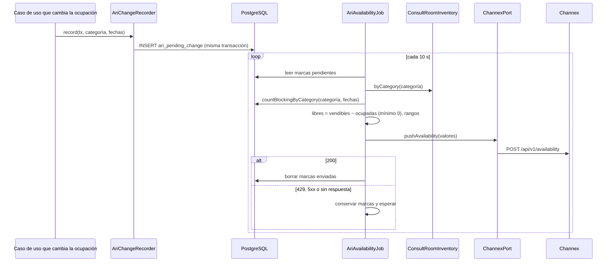
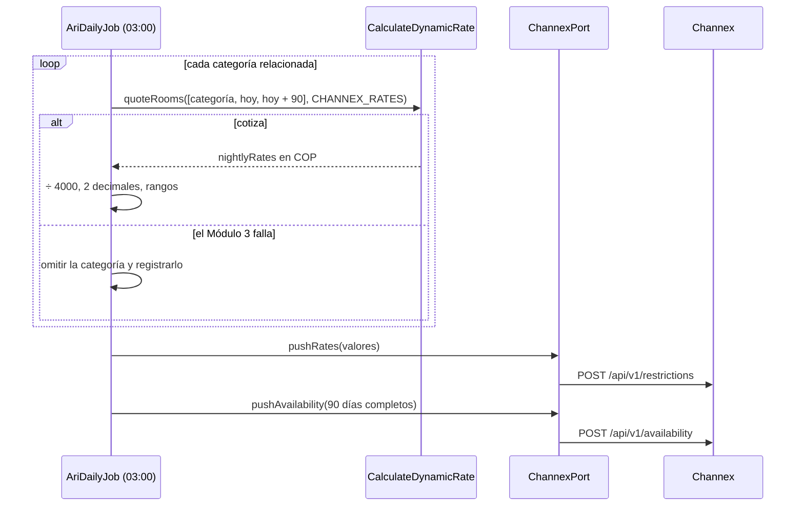

# Implementation Plan: Configurar OTA (`configure-ota`)

**Plan base**: [../base/plan.md](../base/plan.md)
**Spec**: [./spec.md](spec.md)
**Guía**: [../base/guia-planes-por-caso-de-uso.md](../base/guia-planes-por-caso-de-uso.md)

## Summary

Deja configurada la única agencia, **Booking.com**, conectada por **Channex** (`staging.channex.io`), y
mantiene en Channex la **disponibilidad** y las **tarifas** del hotel para que Booking pueda vender. Tiene
tres capacidades:

1. **Configuración al iniciar**: valida la configuración de Channex, registra la `Ota` "Booking.com" con su
   porcentaje de comisión y carga la relación entre los tipos de habitación de Channex y las categorías del
   Módulo 2 (`ota_room_type_mapping`).
2. **Envío de disponibilidad**: cada cambio de ocupación deja una marca (`ari_pending_change`); cada 10
   segundos una tarea agrupa las marcas, calcula las habitaciones libres por categoría y fecha, y las envía
   a Channex.
3. **Envío de tarifas**: a las 03:00 una tarea cotiza con el Módulo 3 los próximos 90 días de cada categoría,
   los convierte a GBP (`4000` COP = 1 GBP) y los envía a Channex, junto con la disponibilidad completa.

No recibe reservas (eso es `generate-ota-reservation`) y **nunca bloquea una reserva**: si Channex, el Módulo
1 o el Módulo 3 fallan, lo pendiente se reintenta (decisión D14 del plan base).

## Resumen técnico e identificación

| Dato | Valor |
|---|---|
| Caso de uso | Configurar OTA (`configure-ota`) |
| Spec | [spec.md](./spec.md), historias 1 a 3, FR-001 a FR-009 |
| Actores | Sistema (inicio y tareas programadas); los demás casos de uso que cambian la ocupación (marcas de disponibilidad) |
| Naturaleza | Escribe `ota`, `ota_room_type_mapping` y `ari_pending_change`; envía a Channex |

| # | Capacidad | Disparador | Contrato |
|---|---|---|---|
| 1 | Configuración al iniciar | Arranque de la aplicación | B1 |
| 2 | Anotar un cambio de ocupación | Llamada interna `AriChangeRecorder.record` | B2 |
| 3 | Enviar disponibilidad pendiente | Tarea `AriAvailabilityJob`, cada 10 s | A1 |
| 4 | Enviar tarifas y disponibilidad completa | Tarea `AriDailyJob`, 03:00 | A1, A2 |

## Technical Context

El stack, la arquitectura hexagonal y el manejo de errores son los del [plan base](../base/plan.md). Lo
propio de este caso de uso:

- **Dependencias nuevas**: ninguna (`ChannexPort` es del plan base; dinero con `decimal.js`).
- **Almacenamiento**: `ota`, `ota_room_type_mapping` y `ari_pending_change` (plan base).
- **Configuración** (plan base): `CHANNEX_BASE_URL`, `CHANNEX_API_KEY`, `CHANNEX_PROPERTY_ID`,
  `BOOKING_HOTEL_ID`, `BOOKING_COMMISSION_PERCENTAGE`, `CHANNEX_COP_PER_GBP` (`4000`),
  `CHANNEX_ARI_INTERVAL_SECONDS` (`10`), `CHANNEX_ARI_DAYS` (`90`), y el archivo
  `config/channex-room-types.json` con la relación de tipos de habitación.
- **Límites de Channex**: 10 solicitudes por minuto por propiedad para disponibilidad y 10 para tarifas.
  Con una solicitud cada 10 s quedan 6 por minuto.
- **Performance** (NFR-001): un cambio de disponibilidad llega a Channex en menos de 1 minuto.

## Contratos

### A. Channex (Módulo 2 → Channex, REST POST)

Cabecera `user-api-key: {CHANNEX_API_KEY}`. La clave nunca se escribe en los logs.

**A1. Disponibilidad por tipo de habitación**: `POST {CHANNEX_BASE_URL}/api/v1/availability`

```json
{
  "values": [
    {
      "property_id": "716305c4-561a-4561-a187-7f5b8aeb5920",
      "room_type_id": "994d1375-dbbd-4072-8724-b2ab32ce781b",
      "date_from": "2026-11-10",
      "date_to": "2026-11-11",
      "availability": 2
    }
  ]
}
```

**A2. Tarifas por plan de tarifa**: `POST {CHANNEX_BASE_URL}/api/v1/restrictions`

```json
{
  "values": [
    {
      "property_id": "716305c4-561a-4561-a187-7f5b8aeb5920",
      "rate_plan_id": "445835fb-7956-42ac-9efc-3e6f331f0808",
      "date_from": "2026-11-10",
      "date_to": "2026-11-12",
      "rate": "62.50"
    }
  ]
}
```

- Las fechas seguidas con el mismo valor se envían juntas, como un rango (`date_from` a `date_to`, ambos
  incluidos), para mandar menos datos.
- Channex responde `200` aunque rechace algún valor: el sistema revisa `meta.warnings` y lo registra en el
  log.
- No se envían fechas pasadas. Las tarifas van como texto decimal con dos decimales.
- Los valores de los ejemplos son ilustrativos.

**Respuestas de Channex y qué hace el sistema**:

| Respuesta | Qué hace |
|---|---|
| `200` | Borra las marcas enviadas (A1) o da por hecho el envío diario (A2) |
| `401` o `403` | Conserva lo pendiente y registra el error; la `Ota` pasa a `DISCONNECTED` |
| `429` | Conserva lo pendiente y espera, con espera creciente, antes del siguiente envío |
| `422` (datos inválidos) | Registra el detalle y descarta ese envío, para no repetir un error permanente |
| `5xx`, tiempo agotado o error de red | Conserva lo pendiente y lo intenta en el siguiente ciclo |

### B. Puertos de entrada internos

```typescript
interface AriChangeRecorder {
  // B2: lo llaman, dentro de su transacción, los casos de uso que cambian la ocupación
  record(tx: Transaction, changes: { categoryRoom: string; dateFrom: string; dateTo: string }[]): Promise<void>;
}

interface OtaRoomTypeMappingRepository {
  findByChannexRoomType(channexRoomTypeId: string): Promise<OtaRoomTypeMapping | null>;  // generate-ota-reservation
  findAll(): Promise<OtaRoomTypeMapping[]>;
}
```

**B1. Configuración al iniciar** (`EnsureChannexSetup`):

1. Valida la configuración: clave, propiedad, id del hotel, porcentaje de 0 a 100 y tasa mayor que cero. Si
   algo falta o es inválido, registra el error y **deja apagadas** las tareas de Channex
   (`generate-ota-reservation` y las de este caso de uso); el resto del Módulo 2 funciona normal.
2. Crea la `Ota` "Booking.com" si no existe (`hotel_account_id = BOOKING_HOTEL_ID`, `CONNECTED`,
   `linked_at` = ahora); si existe y el porcentaje cambió, lo actualiza (solo afecta reservas futuras).
3. Carga `config/channex-room-types.json` y crea o actualiza cada fila de `ota_room_type_mapping`:

```json
[
  { "channexRoomTypeId": "994d1375-dbbd-4072-8724-b2ab32ce781b",
    "channexRatePlanId": "445835fb-7956-42ac-9efc-3e6f331f0808",
    "categoryRoom": "DOBLE" }
]
```

**B2. Anotar un cambio**: inserta una fila en `ari_pending_change` por cada categoría y rango de noches
afectado (`dateFrom` incluido, `dateTo` excluido: el día de salida no se ocupa). Lo llaman
`generate-direct-reservation`, `generate-ota-reservation`, `update-reservation` (modificación, No-Show,
Check-Out y habitaciones `NOT_ARRIVED`) y `cancel-reservation`.

### C. Puertos que usa

| Puerto | De | Para qué |
|---|---|---|
| `ChannexPort.pushAvailability` y `pushRates` | Plan base | A1 y A2 |
| `ConsultRoomInventory.byCategory` | `consult-room-inventory` | Habitaciones vendibles de cada categoría |
| `ReservationLookup.countBlockingByCategory` | `check-view-reservation` (método nuevo) | Habitaciones ocupadas por categoría y fecha |
| `CalculateDynamicRate.quoteRooms` | `calculate-dynamic-rate` | Tarifa de cada noche (contexto nuevo `CHANNEX_RATES`) |
| `OtaConnectionTracker.markDisconnected` | `register-ota-information-commission` | `DISCONNECTED` ante 401/403 |
| `Clock` | Plan base | Hoy y los próximos 90 días |

## Reglas de negocio

1. **Disponibilidad** de una categoría en una fecha = habitaciones vendibles de la categoría (Módulo 1) −
   habitaciones de esa categoría con `blocks_inventory = true` cuyas fechas incluyen esa noche. Si es
   negativa, se envía `0`. Las habitaciones sin asignar no se cuentan, porque no bloquean inventario.
2. **Los mantenimientos no se descuentan**: el Módulo 2 no se entera de cuándo se registran (limitación
   conocida; si Booking vende una habitación en mantenimiento, llega como conflicto).
3. **Agrupación**: cada 10 s se toman todas las marcas pendientes, se unen los rangos por categoría y se
   calcula una sola vez cada categoría y fecha; todo va en una sola solicitud A1.
4. **Tarifas**: una cotización por categoría (`quoteRooms` con una sola solicitud, del día de hoy al día
   90), para que la falla de una categoría no impida las demás. Cada `nightlyRates[].rate` se divide entre
   `CHANNEX_COP_PER_GBP` y se redondea a dos decimales (`ROUND_HALF_UP`).
5. **Envío diario** a las 03:00: primero las tarifas (A2), luego la disponibilidad completa de 90 días (A1).
   Corrige cualquier diferencia que haya quedado.
6. **Sin relación, no se publica**: una categoría sin fila en `ota_room_type_mapping` no se envía.
7. **Tareas con bloqueo asesor** (plan base), para que dos instancias no envíen lo mismo.

## Diagramas de secuencia

### D1. Cambio de disponibilidad (historia 2)



### D2. Envío diario de tarifas (historia 3)



## Modelo de datos y entidades involucradas

**No se crean tablas**: usa `ota`, `ota_room_type_mapping` y `ari_pending_change` del plan base.

## Reglas de validación y manejo de errores

No hay rutas REST. Los errores se registran en el log (sin la clave de Channex) y nunca afectan una
reserva.

| Situación | Qué hace |
|---|---|
| Configuración incompleta o inválida | Tareas de Channex apagadas y error en el log |
| Archivo de tipos de habitación con una categoría o un tipo repetido | No carga el archivo y registra el error |
| Falla del Módulo 1 al contar habitaciones | Conserva las marcas de esa categoría y reintenta |
| Falla del Módulo 3 en una categoría | Omite sus tarifas ese día; Channex conserva las anteriores |
| Respuestas de Channex | Ver la tabla de A |

## Integraciones externas

| Sistema | Dirección | Mecanismo | Ante fallo |
|---|---|---|---|
| Channex | M2 → Channex | REST POST (A1, A2) | Ver la tabla de A |
| Módulo 1 | M2 → M1 | REST GET, a través de `consult-room-inventory` | Reintento en el siguiente ciclo |
| Módulo 3 | M2 → M3 | REST POST, a través de `calculate-dynamic-rate` | Se omite la categoría ese día |

## Arquitectura (capas del plan base)

| Capa | Piezas de este caso de uso |
|---|---|
| `domain/ota/` | `OtaRoomTypeMapping`; función pura `toChannexRanges` (fechas seguidas con el mismo valor) y `copToGbp` |
| `application/use-cases/configure-ota/` | **Entrada**: `EnsureChannexSetup`, `AriChangeRecorder`, `PublishPendingAvailability`, `PublishDailyAri` |
| `application/ports/out/` | `ChannexPort`, `OtaRepository`, `OtaRoomTypeMappingRepository`, `AriPendingChangeRepository` |
| `infrastructure/in/jobs/` | `AriAvailabilityJob` (10 s) y `AriDailyJob` (03:00) |
| `infrastructure/config/` | Validación de las variables de Channex y lectura de `channex-room-types.json` |
| `infrastructure/out/persistence/` | Repositorios de `ota_room_type_mapping` y `ari_pending_change` |

## Phase 1: Setup

- [ ] T001 Validación de las variables de Channex y del archivo `channex-room-types.json`

## Phase 2: Foundational

- [ ] T002 [P] Repositorios de `ota_room_type_mapping` y `ari_pending_change`
- [ ] T003 [P] Funciones puras `toChannexRanges` y `copToGbp` (`decimal.js`), con pruebas unitarias
- [ ] T004 `ReservationLookup.countBlockingByCategory` (en `check-view-reservation`), con pruebas contra PostgreSQL

## Phase 3: User Story 1 - Configuración (P1)

- [ ] T005 [US1] `EnsureChannexSetup`: `Ota` Booking.com y relación de tipos de habitación, sin duplicar
- [ ] T006 [US1] Pruebas de los escenarios 1 a 4

## Phase 4: User Story 2 - Disponibilidad (P1)

- [ ] T007 [US2] `AriChangeRecorder` y su uso en los casos de uso que cambian la ocupación
- [ ] T008 [US2] `PublishPendingAvailability` y `AriAvailabilityJob` (agrupación, mínimo 0, rangos, manejo de 429)
- [ ] T009 [US2] Pruebas de los escenarios 1 a 4

## Phase 5: User Story 3 - Tarifas (P2)

- [ ] T010 [US3] `PublishDailyAri` y `AriDailyJob` (03:00): tarifas de 90 días y disponibilidad completa
- [ ] T011 [US3] Contexto `CHANNEX_RATES` en `calculate-dynamic-rate`
- [ ] T012 [US3] Pruebas de los escenarios 1 y 2

## Phase N: Polish

- [ ] T013 Prueba contra Channex staging: la disponibilidad y las tarifas aparecen en el hotel de prueba de Booking
- [ ] T014 Verificar que la clave de Channex no sale en los logs

## Pruebas por escenario

| Historia | Escenario | Qué se verifica |
|---|---|---|
| US1 | 1 registro de la agencia | Una `Ota` "Booking.com" con el 15 % y `CONNECTED` |
| US1 | 2 reinicio | Sin duplicados; porcentaje nuevo solo para reservas futuras |
| US1 | 3 relación de tipos | Cada tipo de Channex con una categoría y un plan de tarifa |
| US1 | 4 configuración incompleta | Tareas apagadas y el resto del Módulo 2 funcionando |
| US2 | 1 reserva nueva | Disponibilidad `2` para el 10 y el 11 |
| US2 | 2 cancelación | Disponibilidad `3` |
| US2 | 3 agrupación | Cinco reservas en el mismo ciclo: una sola solicitud A1 |
| US2 | 4 Channex caído o 429 | Marcas conservadas y enviadas después |
| US3 | 1 tarifas | `400000` COP → `100.00` GBP en los 90 días |
| US3 | 2 Módulo 3 caído | Sin tarifas de esa categoría; las demás se envían |

## Dependencies & Execution Order

- **Depende de**: el plan base (`ChannexPort`, tablas, tareas), `consult-room-inventory`,
  `check-view-reservation` (`countBlockingByCategory`) y `calculate-dynamic-rate`.
- **Necesitan de este caso de uso**: `generate-ota-reservation` (agencia y relación de tipos) y todos los que
  cambian la ocupación (`AriChangeRecorder`).

## Trazabilidad: requisito → componente → tarea

| Requisito | Componente | Tarea |
|---|---|---|
| FR-001 | Validación de la configuración | T001 |
| FR-002 | `EnsureChannexSetup` (agencia) | T005 |
| FR-003 | `EnsureChannexSetup` (relación de tipos) | T005 |
| FR-004 | `AriChangeRecorder` | T007 |
| FR-005 | `PublishPendingAvailability` y `countBlockingByCategory` | T004, T008 |
| FR-006 | Agrupación cada 10 s y espera ante 429 | T008 |
| FR-007 | `PublishDailyAri` y `copToGbp` | T003, T010 |
| FR-008 | Sin fechas pasadas ni categorías sin relación | T008, T010 |
| FR-009 | Fallos sin efecto en las reservas | T008, T010 |

## Puntos que este plan propone (el spec no los dice)

1. **La relación de tipos de habitación se carga desde un archivo** (`config/channex-room-types.json`) al
   iniciar, con creación o actualización, en lugar de un script aparte.
2. **Un `422` de Channex se descarta** después de registrarlo, para no repetir un error permanente.

## Puntos abiertos

| # | Pendiente | Con quién |
|---|---|---|
| 1 | Restricciones de venta (estancia mínima, cierre de llegadas): hoy no se envían; Channex conserva las que tenga | Equipo del Módulo 2 |

## Notes

- `[P]` marca tareas paralelizables; `[US1]`, `[US2]` y `[US3]` las ligan a su historia de usuario.
- Commit por tarea o grupo lógico, con Gitflow.
