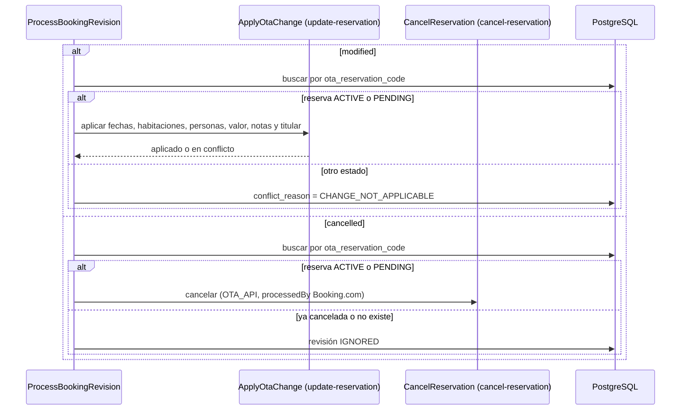

# Implementation Plan: Generar reservación por OTA (`generate-ota-reservation`)

**Plan base**: [../base/plan.md](../base/plan.md)
**Spec**: [./spec.md](spec.md)
**Guía**: [../base/guia-planes-por-caso-de-uso.md](../base/guia-planes-por-caso-de-uso.md)

## Summary

La única agencia es **Booking.com**, conectada por **Channex** (`staging.channex.io`). Booking no llama al
Módulo 2: este caso de uso es una **tarea programada** que cada 60 segundos lee de Channex las revisiones de
reserva pendientes (el *feed*), las procesa y las confirma (`ack`). Cada revisión es:

1. **`new`**: crea la reserva en **`ACTIVE`** (Booking ya la confirmó), con su comisión, asignando
   habitaciones de la categoría relacionada con el tipo de habitación de Channex.
2. **`modified`**: aplica el cambio con `update-reservation`.
3. **`cancelled`**: cancela con `cancel-reservation`, por el canal `OTA_API`.

Booking ya aceptó la reserva, así que **nunca se rechaza**: si no hay habitación, se supera la capacidad o
el cambio no se puede aplicar, se registra igual y se marca **en conflicto** (decisión D13 del plan base).

No tiene rutas REST, pantallas ni colas propias. **No le ordena nada al Módulo 1**: avisa a la lista del día
con `DailyListChangeRecorder`, y anota cada cambio de ocupación para el envío de disponibilidad de
`configure-ota`.

## Resumen técnico e identificación

| Dato | Valor |
|---|---|
| Caso de uso | Generar reservación por OTA (`generate-ota-reservation`) |
| Spec | [spec.md](./spec.md), historias 1 y 2, FR-001 a FR-010 |
| Actor principal | Sistema (tarea programada); Channex como fuente de las reservas de Booking |
| Disparador | Tarea `ChannexFeedJob`, cada `CHANNEX_FEED_INTERVAL_SECONDS` (60) |
| Naturaleza | Lee de Channex; escribe `reservation`, `reservation_room`, `guest`, `commission_audit` y `ota_booking_revision` |

| # | Capacidad | Disparador | Contrato |
|---|---|---|---|
| 1 | Leer el feed | `ChannexFeedJob` | A1 |
| 2 | Procesar una revisión `new` | Interno | B1 |
| 3 | Procesar una revisión `modified` | Interno | B2 |
| 4 | Procesar una revisión `cancelled` | Interno | B3 |
| 5 | Confirmar la revisión a Channex | Después del commit | A2 |

## Technical Context

El stack, la arquitectura hexagonal y el manejo de errores son los del [plan base](../base/plan.md). Lo
propio de este caso de uso:

- **Dependencias nuevas**: ninguna (el cliente de Channex es `ChannexPort`, del plan base).
- **Almacenamiento**: `reservation`, `reservation_room`, `guest`, `commission_audit` y
  `ota_booking_revision` (plan base).
- **Configuración**: `CHANNEX_BASE_URL`, `CHANNEX_API_KEY`, `CHANNEX_PROPERTY_ID` y
  `CHANNEX_FEED_INTERVAL_SECONDS` (plan base).
- **Performance** (NFR-001): una reserva creada en Booking queda registrada en menos de 2 minutos.

## Contratos

### A. Channex (Módulo 2 → Channex, REST)

Cabecera `user-api-key: {CHANNEX_API_KEY}` en todas las llamadas. La clave nunca se escribe en los logs.

**A1. Feed de revisiones**:
`GET {CHANNEX_BASE_URL}/api/v1/booking_revisions/feed?filter[property_id]={CHANNEX_PROPERTY_ID}&order[inserted_at]=asc`

Devuelve las revisiones **no confirmadas**, de la más antigua a la más reciente. Ejemplo de una revisión
(se muestran solo los campos que se usan; los valores son ilustrativos):

```json
{
  "type": "booking_revision",
  "id": "03dd7198-c5b7-493c-a889-74d0c2211de7",
  "attributes": {
    "id": "03dd7198-c5b7-493c-a889-74d0c2211de7",
    "booking_id": "cfa33f3b-bd32-4b90-8ef9-bde2bfe986cd",
    "ota_reservation_code": "9996013801",
    "ota_name": "Booking.com",
    "status": "new",
    "arrival_date": "2026-11-10",
    "departure_date": "2026-11-12",
    "amount": "220.00",
    "currency": "GBP",
    "notes": "Llegada tarde",
    "customer": {
      "name": "Ana",
      "surname": "Pérez",
      "mail": "ana@correo.com",
      "phone": "+57 300 000 0000",
      "country": "CO"
    },
    "rooms": [
      {
        "room_type_id": "994d1375-dbbd-4072-8724-b2ab32ce781b",
        "rate_plan_id": "445835fb-7956-42ac-9efc-3e6f331f0808",
        "checkin_date": "2026-11-10",
        "checkout_date": "2026-11-12",
        "occupancy": { "adults": 2, "children": 0, "infants": 0 }
      }
    ]
  }
}
```

**A2. Confirmar una revisión**: `POST {CHANNEX_BASE_URL}/api/v1/booking_revisions/{id}/ack`. Responde
`200`. Una revisión sin confirmar vuelve a aparecer en el feed (Channex avisa por correo a los 30 minutos).

**Respuestas de Channex y qué hace el sistema**:

| Respuesta | Qué hace |
|---|---|
| `200` | Procesa las revisiones |
| `401` o `403` | Pasa la `Ota` a `DISCONNECTED` (`register-ota-information-commission`) y no procesa nada |
| `429` | Espera y reintenta con espera creciente; no procesa nada en esa lectura |
| `5xx`, tiempo agotado o error de red | No procesa nada y lo intenta en la siguiente lectura |

### B. Procesamiento de una revisión

**Correspondencia de campos** (revisión → Módulo 2):

| Channex | Módulo 2 |
|---|---|
| `id` | `ota_booking_revision.revision_id` (idempotencia) |
| `booking_id` | `ota_booking_revision.booking_id` |
| `ota_reservation_code` | `reservation.external_confirmation_code` |
| `arrival_date`, `departure_date` | `start_date`, `end_date` |
| `amount`, `currency` | `gross_amount` (`totalAmount`), `currency` |
| `notes` | `notes`, saneado y recortado a 500 caracteres |
| `customer.name`, `surname`, `mail`, `phone` | `guest.first_name`, `last_name`, `contact_email`, `contact_phone` |
| `customer.country` | `guest.nationality`: nombre del país según la tabla `CountryNames` (`CO` → `Colombia`); vacía si el código no está |
| — | `guest.document_type` y `document_number` vacíos (Booking no los envía) |
| `rooms[].room_type_id` | `category_room`, según `ota_room_type_mapping` (`configure-ota`) |
| `rooms[].occupancy.adults + children` | `reservation_room.guest_count` (los bebés no se cuentan) |

**B1. `new`**: dentro de **una transacción**:

1. Si la revisión ya está en `ota_booking_revision`, no hace nada (solo repite el `ack` si faltaba).
2. Si el `ota_reservation_code` ya existe para la agencia, la trata como `modified` (B2).
3. Relaciona cada habitación con su categoría. Si un tipo no tiene relación, **no guarda nada ni confirma**
   la revisión: queda en el feed hasta que se complete la relación en `configure-ota`.
4. Consulta la disponibilidad de cada categoría (`VerifyAvailability.check`) y asigna con `assignRooms` la
   de menor `roomNumber`, sin repetir. Las que no tengan habitación libre quedan **sin asignar**
   (`room_id` vacío, `blocks_inventory = false`).
5. Crea la `Reservation` en `ACTIVE`, con `source = OTA`, `ota_id` de Booking.com y el titular nuevo.
6. Calcula la comisión con `RegisterOtaConfirmationAndCommission.calculate` y escribe su auditoría.
7. Si hay habitaciones sin asignar, marca `NO_ROOM_AVAILABLE`; si alguna supera su `maxCapacity`,
   `CAPACITY_EXCEEDED` (si hay las dos, la primera).
8. Llama a `DailyListChangeRecorder.record` (`ADDED` si la llegada es hoy y la lista ya salió) y a
   `AriChangeRecorder.record` (categorías y fechas).
9. Inserta la fila de `ota_booking_revision` (`APPLIED` o `CONFLICT`).

Después del commit envía el `ack` (A2) y guarda `acked_at`.

**B2. `modified`**: busca la reserva por `ota_reservation_code`.

- Si no existe, la procesa como `new` (B1).
- Si está en `ACTIVE` o `PENDING`, llama a `ApplyOtaChange` de `update-reservation` con las fechas, las
  habitaciones y las personas, el valor, las observaciones y el titular nuevos. Ese caso de uso conserva o
  reasigna habitaciones, deja sin asignar las que no tengan lugar, marca el conflicto si hace falta y
  recalcula la comisión con el porcentaje congelado.
- Si está en `IN_PROGRESS`, `COMPLETED`, `NO_SHOW` o `CANCELLED`, no la cambia y la marca
  `CHANGE_NOT_APPLICABLE`.

**B3. `cancelled`**: busca la reserva por `ota_reservation_code`.

- Si no existe, solo registra la revisión como `IGNORED` y confirma.
- Si está en `CANCELLED`, no hace nada más y confirma.
- Si está en `ACTIVE` o `PENDING`, llama a `CancelReservation` con canal `OTA_API` y `processedBy`
  `Booking.com`.
- Si está en `IN_PROGRESS`, `COMPLETED` o `NO_SHOW`, la marca `CHANGE_NOT_APPLICABLE`.

### C. Puertos que usa

| Puerto | De | Para qué |
|---|---|---|
| `ChannexPort.fetchBookingFeed` y `ackBookingRevision` | Plan base | A1 y A2 |
| `OtaRoomTypeMappingRepository.findByChannexRoomType` | `configure-ota` | Categoría de cada habitación |
| `VerifyAvailability.check` y `assignRooms` | `check-room-availability` | Disponibilidad y asignación (sin `requireAvailable`: nunca se rechaza) |
| `RegisterOtaConfirmationAndCommission.calculate` y `recordAudit` | `register-ota-information-commission` | Comisión y auditoría |
| `OtaConnectionTracker.markSynced` y `markDisconnected` | `register-ota-information-commission` | `lastSyncAt` y `connectionStatus` |
| `ApplyOtaChange` | `update-reservation` | Revisiones `modified` |
| `CancelReservation` | `cancel-reservation` | Revisiones `cancelled` |
| `DailyListChangeRecorder.record` | `check-view-reservation` | Avisos a la lista del día |
| `AriChangeRecorder.record` | `configure-ota` | Disponibilidad pendiente para Channex |
| `ReservationStatusService` | `update-reservation` | Estado inicial `ACTIVE` y `stayStatus` `EXPECTED` |
| `Clock` | Plan base | Día operativo en curso |

## Reglas de negocio

1. **Una revisión, un procesamiento**: la clave es el `id` de la revisión (`ota_booking_revision`), no el
   `booking_id`, porque una misma reserva tiene varias revisiones.
2. **El `ack` va después del commit.** Si el `ack` falla, la fila queda con `acked_at` vacío y se repite en
   la siguiente lectura, sin volver a aplicar la revisión.
3. **Orden**: se procesan en el orden del feed (`inserted_at` ascendente), una por una; una que falla no
   detiene a las siguientes, salvo que sea de la misma reserva (se detiene esa reserva hasta la siguiente
   lectura, para no aplicar un cambio antes que su alta).
4. **Nunca se rechaza** una reserva o un cambio de Booking (D13).
5. **Sin cotización**: no llama al Módulo 3 (decisión C5). El valor bruto se guarda tal cual, en la moneda
   de Booking (`GBP` en el hotel de prueba).
6. **Estado inicial `ACTIVE`**; `PENDING` no se usa.
7. **Titular propio de la reserva**, sin documento y con la nacionalidad informativa.
8. **`lastSyncAt`**: cada lectura del feed que termina bien lo actualiza, traiga o no revisiones.

## Diagramas de secuencia

### D1. Lectura del feed y reserva nueva (historia 1, escenarios 1 a 5)

```mermaid
sequenceDiagram
    participant J as ChannexFeedJob
    participant P as ChannexPort
    participant CX as Channex
    participant U as ProcessBookingRevision
    participant V as VerifyAvailability
    participant DB as PostgreSQL

    J->>P: fetchBookingFeed()
    P->>CX: GET /booking_revisions/feed (user-api-key)
    CX-->>P: revisiones (más antigua primero)
    J->>J: markSynced (lastSyncAt)
    loop cada revisión
        J->>U: process(revisión)
        U->>DB: ¿revisión ya procesada?
        alt ya procesada
            U-->>J: repetir ack si faltaba
        else nueva
            U->>U: relacionar tipos de habitación con categorías
            U->>V: check(categoría, fechas)
            U->>U: assignRooms; las que no caben, sin asignar
            U->>DB: BEGIN; reserva ACTIVE, habitaciones, titular, comisión, conflicto, avisos, revisión; COMMIT
            J->>P: ackBookingRevision(id)
            P->>CX: POST /booking_revisions/{id}/ack
            J->>DB: acked_at
        end
    end
```

### D2. Cambio y cancelación (historia 2)



## Modelo de datos y entidades involucradas

**No se crean tablas**: usa las del plan base.

| Tabla | Qué guarda |
|---|---|
| `reservation` | `source = OTA`, `ota_id`, `external_confirmation_code`, `status = ACTIVE`, fechas, `guest_count`, `notes`, `gross_amount`, `currency`, comisión y, si aplica, `conflict_reason` y `conflict_detected_at` |
| `reservation_room` | Una por habitación; `room_id` y `room_number` vacíos y `blocks_inventory = false` si quedó sin asignar; sin tarifa por habitación |
| `guest` | Titular nuevo, sin documento |
| `commission_audit` | Fila `CALCULATED` (`register-ota-information-commission`) |
| `ota_booking_revision` | Una fila por revisión procesada, con su resultado y `acked_at` |

## Reglas de validación y manejo de errores

No hay respuestas HTTP propias: los errores se registran en el log (sin datos personales) y deciden si la
revisión se confirma.

| Situación | ¿Se guarda? | ¿Se confirma (`ack`)? |
|---|---|---|
| Revisión aplicada | Sí | Sí |
| Sin habitación o capacidad superada | Sí, en conflicto | Sí |
| Cambio o cancelación en un estado que no lo admite | Se marca el conflicto | Sí |
| Cancelación de una reserva inexistente o ya cancelada | No (revisión `IGNORED`) | Sí |
| Tipo de habitación sin relación | No | **No**: vuelve en la siguiente lectura |
| Payload ilegible o sin `ota_reservation_code` | No | **No**: queda en el log para revisión |
| Falla de la base de datos o del Módulo 1 | No (se revierte) | **No**: se procesa en la siguiente lectura |

## Integraciones externas

| Sistema | Dirección | Mecanismo | Ante fallo |
|---|---|---|---|
| Channex | M2 → Channex | REST GET (feed) y POST (`ack`) | Ver la tabla de A |
| Módulo 1 | M2 → M1 | REST GET, a través de `check-room-availability` | La revisión no se confirma y se reintenta |

## Arquitectura (capas del plan base)

| Capa | Piezas de este caso de uso |
|---|---|
| `domain/reservation/` | Fábrica `Reservation.createOta(...)` (estado `ACTIVE`, habitaciones sin asignar, conflicto) |
| `domain/shared/` | `CountryNames` (código de dos letras → nombre del país) |
| `application/use-cases/generate-ota-reservation/` | **Entrada**: `ReadBookingFeed`, `ProcessBookingRevision`; mapeador de la revisión |
| `application/ports/out/` | `ChannexPort`, `OtaBookingRevisionRepository`, `ReservationRepository` y los puertos de C |
| `infrastructure/in/jobs/` | `ChannexFeedJob` (cada 60 s, con bloqueo asesor) |
| `infrastructure/out/channex/` | Adaptador HTTP de `ChannexPort` (plan base) |
| `infrastructure/out/persistence/` | `OtaBookingRevisionRepository` |

## Phase 1: Setup

- [ ] T001 [P] `CountryNames`: tabla fija de códigos de país a nombres, con pruebas

## Phase 2: Foundational

- [ ] T002 `OtaBookingRevisionRepository` sobre `ota_booking_revision`
- [ ] T003 Mapeador de la revisión de Channex a los datos del Módulo 2 (tabla de B), con saneo y recorte de `notes`
- [ ] T004 Fábrica `Reservation.createOta` con habitaciones sin asignar y conflicto

## Phase 3: User Story 1 - Reservas nuevas (P1)

- [ ] T005 [US1] `ReadBookingFeed` y `ChannexFeedJob`: lectura, `lastSyncAt`, `DISCONNECTED` ante 401/403 y espera ante 429
- [ ] T006 [US1] `ProcessBookingRevision` para `new` (B1), en una transacción
- [ ] T007 [US1] `ack` después del commit y repetición de los `ack` pendientes
- [ ] T008 [US1] Pruebas de integración de los escenarios 1 a 7 con Channex simulado

## Phase 4: User Story 2 - Cambios y cancelaciones (P1)

- [ ] T009 [US2] `modified` (B2) con `ApplyOtaChange`
- [ ] T010 [US2] `cancelled` (B3) con `CancelReservation`
- [ ] T011 [US2] Pruebas de integración de los escenarios 1 a 5

## Phase N: Polish

- [ ] T012 Prueba contra Channex staging: reserva de prueba en Booking (`hotel_id` de prueba, tarjeta `4111 1111 1111 1111`) creada, cambiada y cancelada
- [ ] T013 Verificar que ni la clave de Channex ni los datos personales salen en los logs

## Pruebas por escenario

| Historia | Escenario | Qué se verifica |
|---|---|---|
| US1 | 1 reserva nueva | `ACTIVE`, código de Booking, valor y moneda, habitación 201 en `EXPECTED`, comisión exacta y `ack` enviado |
| US1 | 2 revisión repetida | Una sola reserva; segundo `ack` sin cambios |
| US1 | 3 varias habitaciones | Habitaciones 201 y 202 en una sola reserva |
| US1 | 4 sin habitación | Reserva con la habitación sin asignar y `NO_ROOM_AVAILABLE`; `ack` enviado |
| US1 | 5 capacidad superada | Reserva con `CAPACITY_EXCEEDED`; `ack` enviado |
| US1 | 6 tipo sin relación | Nada guardado y **sin** `ack` |
| US1 | 7 Channex caído o 429 | Nada procesado; reintento en la siguiente lectura |
| US2 | 1 cambio de fechas | `end_date`, valor y comisión nuevos |
| US2 | 2 cambio sin disponibilidad | Fechas nuevas, habitación sin asignar y `NO_ROOM_AVAILABLE` |
| US2 | 3 cancelación | `CANCELLED`, `Cancellation` con `OTA_API`, comisión intacta |
| US2 | 4 cambio no aplicable | Reserva intacta con `CHANGE_NOT_APPLICABLE` |
| US2 | 5 cancelación repetida | Sin cambios; `ack` enviado |

## Dependencies & Execution Order

- **Depende de**: el plan base (`ChannexPort`, tablas, tareas programadas), `configure-ota` (agencia y
  relación de tipos), `check-room-availability`, `register-ota-information-commission`,
  `update-reservation` (`ApplyOtaChange`), `cancel-reservation` y `check-view-reservation`.
- **Necesitan de este caso de uso**: ninguno.

## Trazabilidad: requisito → componente → tarea

| Requisito | Componente | Tarea |
|---|---|---|
| FR-001 | `ChannexFeedJob` y `ReadBookingFeed` | T005 |
| FR-002 | `ota_booking_revision` y `ack` después del commit | T002, T007 |
| FR-003 | `ProcessBookingRevision` (B1) y `Reservation.createOta` | T004, T006 |
| FR-004 | `RegisterOtaConfirmationAndCommission` | T006 |
| FR-005 | B2 con `ApplyOtaChange` | T009 |
| FR-006 | B3 con `CancelReservation` | T010 |
| FR-007 | Habitaciones sin asignar y `conflict_reason` | T004, T006 |
| FR-008 | Mapeador y `CountryNames` | T001, T003 |
| FR-009 | `DailyListChangeRecorder` y `AriChangeRecorder` | T006 |
| FR-010 | Una transacción por revisión y reintentos | T005, T006 |

## Puntos que este plan propone (el spec no los dice)

1. **Una revisión `modified` de una reserva desconocida se procesa como `new`.**
2. **Si una revisión de una reserva falla, las siguientes de esa misma reserva esperan** a la siguiente
   lectura, para no aplicar un cambio antes que su alta.
3. **`processedBy` de la cancelación de Booking** es `Booking.com`.

## Puntos abiertos

| # | Pendiente | Con quién |
|---|---|---|
| 1 | Las reservas con varias habitaciones de **fechas distintas** dentro de la misma reserva (Channex lo permite por habitación): el Módulo 2 usa fechas comunes; hoy se toman las de la reserva (`arrival_date`, `departure_date`) | Equipo del Módulo 2 |

## Notes

- `[P]` marca tareas paralelizables; `[US1]` y `[US2]` las ligan a su historia de usuario.
- Commit por tarea o grupo lógico, con Gitflow.
